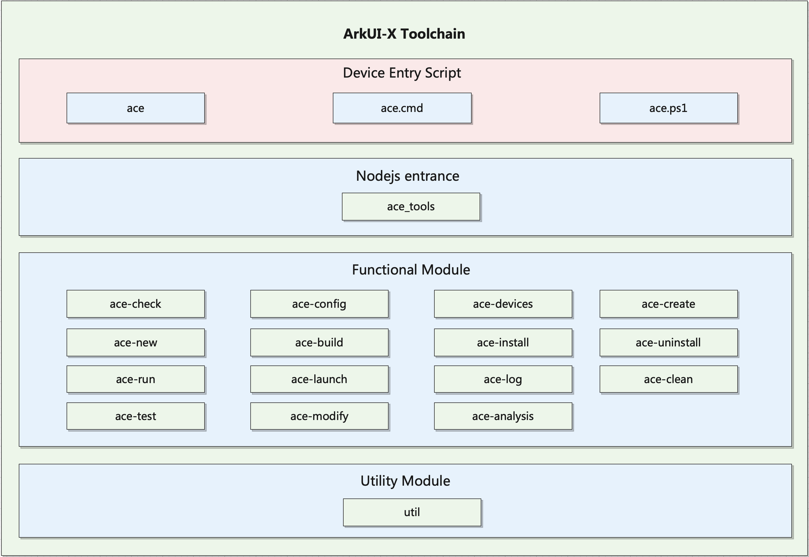

# ACE Tools

## Introduction
ACE Tools is a command line (CLI) tool that allows ArkUI-X project developers to build applications on the OpenHarmony, Android, and iOS platforms. Its functions include development environment check, project creation, building and packaging, and installation and debugging.

For details about setting up an environment for using ACE Tools，see [ACE Tools Quick Guide](https://gitcode.com/arkui-x/docs/blob/master/zh-cn/application-dev/quick-start/start-with-ace-tools.md).

ACE stands for Ability Cross-platform Environment. It is a cross-platform programming framework dedicated to OpenHarmony.

**Figure 1** Structure of ACE Tools



The script file used as the tool entry varies depending on the platform. Use the appropriate script file to launch the tool. Then, run **ace_tools.js** through Node.js, and use the commander module of npm to parse the commands and execute the exported methods of each sub-module.

## Directory Structure
For details about the source code structure of the ArkUI-X project, see [ArkUI-X Project Structure](https://gitcode.com/arkui-x/docs/blob/master/en/framework-dev/quick-start/project-structure-guide.md). The code of the ACE Tools is available at **//developtools/ace_tools**. The directory structure is as follows:

```
/developtools/ace_tools/cli
├── src                         # Source code
│   ├── ace-build               # Build code
│   ├── ace-check               # Development environment checking
│   ├── ace-clean               # Build result clearing
│   ├── ace-config              # ACE toolchain configuration
│   ├── ace-create              # Project and application templates
│   ├── ace-devices             # Query of all connected ACE devices
│   ├── ace-install             # ArkUI-X application installation
│   ├── ace-launch              # ArkUI-X application launch
│   ├── ace-log                 #  ArkUI-X application run log
│   ├── ace-modify              # modify the project to ArkUI-X/ directories.
│   ├── ace-analysis            # Analyze the interface that does not support cross-platform in the ArkUI-X project and output statistics
│   ├── ace-run                 # ArkUI-X application build and run
|   ├── ace-test                # ArkUI-X application build and excute test case like unitTest or uiTest
│   ├── ace-uninstall           # ArkUI-X application uninstall
│   ├── bin                     # Device entry scripts
│   └── util                    # Utilities
└── templates                   # Templates
    ├── andriod                 # Android project templates
    ├── ets_fa                  # ArkTS-based declarative development paradigm templates
    ├── ios                     # iOS project templates
    ├── js_fa                   # JS-compatible web-like development paradigm templates
    └── ohos_fa                 # OpenHarmony project templates
```

## How to Use

### ace config

Adds ACE Tools-specific configuration, including the OpenHarmony SDK directory, Android SDK directory, Node.js directory, and build output directory.

Syntax:

```shell
ace config [options] <path>
```

| Parameter         | Description               |
| ------------- | ------------------- |
| --openharmony-sdk | OpenHarmony SDK directory.|
| --android-sdk | Android SDK directory.   |
| --nodejs-dir  | Node.js directory.       |
| --build-dir   | Build output directory.    |
| --deveco-studio-path | DevEco Studio installation directory (optional).|
| --android-studio-path | Android Studio installation directory (optional).|
| --java-sdk | JDK directory.|
| --nodejs-dir  | Node.js directory。        |
| --ohpm-dir  | Ohpm directory。 |
| --openharmony-sdk | OpenHarmony SDK directory。 |
| --source-dir | ArkUI-X code directory。 |
| --command-line-tools-path | Command Line Tools directory（only linux） |

For example, using ace config to configure the OpenHarmony SDK path:
```shell
ohos@user ~ % ace config --openharmony-sdk /Users/ohos/Library/OpenHarmony/Sdk
Set "openharmony-sdk" value to "/Users/ohos/Library/OpenHarmony/Sdk" succeeded.
```

Note: If there are spaces in the configuration path, double quotation marks need to be added to the path, for example:
```shell
ohos@user ~ % ace config --openharmony-sdk "/Users/ohos/Library/Open Harmony/Sdk"
Set "openharmony-sdk" value to "/Users/ohos/Library/Open Harmony/Sdk" succeeded.
```

### ace check

Checks the ArkUI-X application development environment.

The following table lists the check items.

| Item        | Description                        | Windows | Linux | Mac  |
| ---------------- | ---------------------------- | ------- | ----- | ---- |
| adb | Android debug tool | Yes | Yes | Yes |
| Android SDK      | Android SDK directory.             | Yes     | Yes   | Yes  |
| Android Studio   | Android Studio installation directory.      | Yes     | Yes   | Yes  |
| ArkUI-X SDK      | ArkUI-X SDK directory             | Yes      | Yes     | Yes |
| ArkUI-X source   | ArkUI-X code directory              | Yes      | Yes    | Yes |
| DevEco Studio    | DevEco Studio installation directory.       | Yes     | No   | Yes  |
| Command Line Tools    | Command Line Tools directory        | No      | Yes    | No   |
| HarmonyOS hdc | HarmonyOS device debug tool | Yes | Yes | Yes |
| HarmonyOS SDK    | HarmonyOS SDK directory          | Yes      | Yes    | Yes   |
| ios-deploy       | ios-deploy version.      | No     | No   | Yes  |
| libimobiledevice | libimobiledevice version.| No     | No   | Yes  |
| Node.js           | Node.js directory.                 | Yes     | Yes   | Yes  |
| Ohpm            | Ohpm directory                   | Yes      | Yes     | Yes |
| OpenHarmony SDK  | OpenHarmony SDK directory.         | Yes     | Yes   | Yes  |
| OpenHarmony hdc | OpenHarmony debug tool | Yes | Yes | Yes |
| Xcode            | Xcode version.           | No     | No   | Yes  |
| Connected device        | All currently connected devices.          | Yes     | Yes   | Yes  |

Syntax:

```shell
ace check
```

No parameters need to be specified.

Reference command output:

```shell
ohos@user ~ % ace check
[√] OpenHarmony toolchains - develop for OpenHarmony devices
  • SDK at /Users/ohos/Desktop/sdk
  • Node.js Runtime Environment at /usr/local/bin/node
  • Java SDK at /Library/Java/JavaVirtualMachines/jdk-18.0.2.1.jdk/Contents/Home
[√] Android toolchains - develop for Android devices
  • SDK at /Users/ohos/Library/Android/sdk
[√] DevEco Studio
  • DevEco Studio at /Applications/deveco-studio.app
[!] Android Studio
  ! Android Studio is not installed, you can install in https://developer.android.google.cn/studio 
[√] iOS toolchains - develop for iOS devices
  • Xcode 13.3Build version 13E113
  • idevicesyslog 1.3.0
  • 1.11.4
Tools info :[×] hdc is not installed [√] adb installed [√] ios-deploy installed
[√] Connected device (1 available)
  • iOS Devices	[....] Found 00008020-001C0D92146A002E (N841AP, iPhone XR, iphoneos, arm64e, 15.0, 19A346) a.k.a. 'iPhone Xr 15.0' connected through USB.

  √ Ace-check found no issues.

ohos@user:~$ ace check -v
[√] ArkUI-X (ArkUI-X SDK version 5.0.2.58)
  • ArkUI-X SDK at /home/user/Arkui-x/SDK
  • Node.js (v16.20.1) Runtime Environment at /home/user/cli/cli/bin/node
[√] OpenHarmony toolchains - develop for OpenHarmony devices (OpenHarmony SDK version 5.0.2.123)
  • OpenHarmony SDK at /home/user/OpenHarmony/Sdk
  • Ohpm at /home/user/command-line-tools
  • Java SDK at /home/user/JDK/jdk-17.0.6/
  • Java(TM) SE Runtime Environment (build 17.0.6+9-LTS-190)
[√] HarmonyOS toolchains - develop for HarmonyOS devices (HarmonyOS SDK version 5.0.2)
  • HarmonyOS SDK at /home/user/command-line-tools/sdk
  • Ohpm at /home/user/command-line-tools
  • Java SDK at /home/user/JDK/jdk-17.0.6/
  • Java(TM) SE Runtime Environment (build 17.0.6+9-LTS-190)
[√] Android toolchains - develop for Android devices (Android SDK version 30.0.3)
  • Android SDK at /home/user/Android/Sdk
  • Java SDK at /home/user/AndroidStudio/android-studio/jbr
  • OpenJDK Runtime Environment (build 17.0.6+0-17.0.6b829.9-10027231)
[√] Command Line Tools
  • Command Line Tools at /home/user/command-line-tools
[√] Android Studio (version AI-223.8836.35.2231.11005911)
  • Android Studio at /home/user/AndroidStudio/android-studio
  • Java SDK at /home/user/AndroidStudio/android-studio/jbr
  • OpenJDK Runtime Environment (build 17.0.6+0-17.0.6b829.9-10027231)
Tools info :[√] OpenHarmony hdc installed
            [√] HarmonyOS hdc installed
            [√] adb installed

[!] No connected device

  ! ACE Tools found issues in 1 category.
```

### ace devices

Lists all connected devices. On Windows and Linux, you can query the currently connected Android and OpenHarmony devices. 

On Mac, you can query the currently connected Android, OpenHarmony, and iOS devices.


Syntax:

```shell
ace devices
```

No parameters need to be specified.

Reference command output:

```shell
ohos@user ~ % ace devices
Tools info :[×] hdc is not installed [√] adb installed [√] ios-deploy installed
[√] Connected device (1 available)
  • iOS Devices	[....] Found 00008020-001C0D92146A002E (N841AP, iPhone XR, iphoneos, arm64e, 15.0, 19A346) a.k.a. 'iPhone Xr 15.0' connected through USB.
```

### ace create project

Creates an ArkUI-X project.

If the project already exists, a prompt is displayed, asking you whether to delete the project.

When creating a project, you need to specify the project name and package name in sequence. If you do not enter the package name, it will be defaulted to **com.example.***project name*.


Syntax:

```shell
ace create project [options]
```

- options

| Option               | Description                                      |
| --------------------- | ------------------------------------------ |
| -t  --template \<type\>  | Specifies the template type of the project to create.                  |
| -h --help             | Displays the help information.                            |

- type

| type        | Description                      |
| ----------- | ------------------------- |
| app         | Creates a standard ArkUI-X application project. |
| library     | Creates an aar/framework project.   |
| plugin_napi | Creates a native project.          |
| ffi         | Creates a cross-platform plugin project (FFI form, precompiled C++, suitable for C libraries such as encryption and image processing). |
| plugin      | Creates a cross-platform plugin project (Plugin form, precompiled C++ + Java/Kotlin, suitable for platform APIs such as Bluetooth, camera, and sensors). |
| package     | Creates a cross-platform plugin project (Package form, pure ArkTS, no native code, suitable for UI component libraries and utility libraries). |

> The `ffi`, `plugin`, and `package` forms correspond to cross-platform plugin development projects. After creation, you can use `ace build plugin` to build them into a cross-platform HAR package and distribute it via `ohpm publish`. For details, see [ace build plugin](#ace-build-plugin-cross-platform-plugin-build) and [ace install \<name\>.har](#ace-install-har-plugin-installation).

Prompt asking whether to delete the existing project:

```shell
The project already exists. Do you want to delete the directory (Y / N):
```

Prompt indicating that the existing project is deleted successfully:

```shell
Delete directory successfully, creating new project...:
```

Prompt indicating a failure to delete the existing project:

```shell
Failed to create project, project directory already exists!
```

Prompt for entering the project name:

```shell
Please input project name:
```

Prompt for entering the package name:

```shell
Please input package name: com.example.${projectName}:
```

Prompt for entering the project version:

```shell
Please enter the ACE version (1: ArkTS-based declarative development paradigm, 2: JS-compatible web-like development paradigm):
```

Prompt indicating that the project is created successfully:

```shell
Project created. Target directory: ${projectName}
```

### ace create module

Creates an ArkUI-X application module.


You need to run the command in the **source** directory of the newly created ArkUI-X project. Then, enter the module name at the following prompt:

```shell
Please input module name:
```

If the module name already exists, the system displays the message **${module name} already exists**. Change the module name, and press **Enter**. The ArkUI-X application module is successfully created.

### ace build

Builds an ArkUI-X application installation package.

Syntax:

```shell
ace build [options] [fileType]
```

You can build HAP and APK packages on Windows and Linux, and build HAP, APK, and App packages on Mac.

**Note:** On DevEco Studio, open the project to build and enable automatic signing as follows: Go to **File** > **Project Structure** > **Project** > **Signing Configs**, and select **Automatically generate signature**. Then, run the **ace build** command to build the signed HAP installation package. On Mac, use Xcode to open the corresponding iOS project, enable automatic signing on the **Singing** tab on the **Build settings** page, and run the build command.

- options

| Option               | Description                                      |
| --------------------- | ------------------------------------------ |
| --target [moduleName] | Specifies the name of the target module.                  |
| -r --release          | Sets the type of the application to **release**. The default type is **debug**.|
| --nosign              | Builds an unsigned application (for App package only).         |
| -h --help             | Displays the help information.                            |

- fileType

| Parameter| Description                                                  |
| ---- | ------------------------------------------------------ |
| hap  | HAP package of the OpenHarmony application. If **fileType** is not specified, the value is defaulted to **hap**.|
| apk  | APK package of the Android application.                                 |
| app  | App package of the iOS application.                                  |
| plugin | Cross-platform plugin HAR package (unified output of the FFI/Plugin/Package forms). |

Reference command output:

```shell
HAP file built successfully..
File path: /Users/ohos/WorkSpace/demo/ohos/entry/build/default/outputs/default
```

#### ace build plugin Cross-Platform Plugin Build

`ace build plugin` builds a cross-platform plugin project created via `ace create -t <ffi|plugin|package>` and produces a unified HAR package containing HarmonyOS, Android (AAR), and iOS (xcframework) artifacts.

Syntax:

```shell
ace build plugin
```

> This command must be run in the root directory of the cross-platform plugin project (the project that contains `.arkui-x/crossplatform-config.json5`). The `--target` parameter is not supported. The module name is auto-discovered by `discoverHarModule()` (which reads the `name` field of `crossplatform-config.json5`, then the `file:` dependency name in the root `oh-package.json5`, and finally the non-entry module in `build-profile.json5`).

Build pipeline:

| Phase | Platform | Artifact | Description |
| ---- | ---- | ---- | ---- |
| Phase 1 | HarmonyOS | `<module>.har` | Hvigor assembleHar produces the standard HAR. |
| Phase 2 | Android (FFI/Plugin) | `<module>-release.aar` | Reuses the `ace build aar` capability; Gradle assembleRelease compiles the AAR and strips the engine library `libarkui_android.so`. |
| Phase 3 | iOS (FFI/Plugin, macOS only) | `<Module>.xcframework` | Skipped automatically on non-macOS with a warning; the `ios/` directory is not embedded into the HAR. |
| Phase 4 | Package | Final `<module>.har` | Packs `package/`, `crossplatform-config.json5`, `android/`, and `ios/` into a HAR (gzip tar) with a peer-level directory structure. |

After the build is complete, the final cross-platform HAR artifact is generated at `build/outputs/<moduleName>.har` in the project root directory:

```shell
Cross-platform plugin HAR built: /Users/ohos/WorkSpace/my-plugin/build/outputs/avsession.har
  Type: plugin  Module: avsession
```

> A single platform failure still generates the HAR (the corresponding platform field in the config is left empty). The HAR generation is aborted only when both Android and iOS fail.

### ace install

Installs an ArkUI-X application on a connected device.


Syntax:

```shell
ace install [options] [fileType]
```

You can install HAP and APK packages on Windows and Linux, and install HAP, APK, and App packages on Mac.

- options

| Option             | Description              |
| ------------------- | ------------------ |
| -d [deviceId]       | Specifies the ID of the device for installing the application.|
| --device [deviceId] | Specifies the ID of the device for installing the application.|

- fileType

| Parameter| Description                                                  |
| ---- | ------------------------------------------------------ |
| hap  | HAP package of the OpenHarmony application. If **fileType** is not specified, the value is defaulted to **hap**.|
| apk  | APK package of the Android application.                                 |
| app  | App package of the iOS application.                                  |
| \<name\>.har | Installs a cross-platform plugin HAR package into the current project (must be run in the ArkUI-X project root directory). Optional. |

Command output:

```shell
ohos@user % ace install app
Install APP successfully.
```

#### ace install HAR Plugin Installation

When the argument (or the path specified by `--path`) of `ace install` ends with `.har`, the command enters the cross-platform plugin installation flow, which installs the HAR package into the current ArkUI-X project instead of installing it onto a device.

Syntax:

```shell
ace install <name>.har
# Equivalent form
ace install --path <name>.har
```

**HAR Package Path Format**:

- The argument `<name>.har` is the file path of the HAR package. **Using an absolute path is recommended** to avoid file-not-found errors caused by a different working directory. The tool resolves the path internally via `path.resolve()`. A relative path is resolved against the current working directory, while an absolute path is independent of the working directory and therefore the most reliable.
- If the path contains spaces, enclose it in double quotation marks, for example: `ace install "/Users/ohos/Downloads/my plugin.har"`.
- On Windows, both backslash (`\`) and forward slash (`/`) are accepted as path separators; the tool normalizes them. The `file:` dependency path written into `oh-package.json5` is automatically converted to forward slashes for cross-platform consistency.
- This command must be run in the **root directory of the target ArkUI-X application project** (the project must contain a `.arkui-x/` directory); otherwise, the message `Not an ArkUI-X project. .arkui-x/ not found.` is displayed.

macOS absolute path example:

```shell
ohos@user ~/my-app % ace install /Users/ohos/WorkSpace/my-plugin/build/outputs/avsession.har
Extracting HAR: avsession.har
  Flattened package/ to root level
Installing: avsession@1.0.0 (type: plugin)
Android integration: copied avsession-release.aar to .arkui-x/android/app/libs/
iOS integration: copied AVSession.xcframework to .arkui-x/ios/frameworks/
ohpm install completed.
Plugin installed. Remember to register the plugin class in your entry code.
```

Windows absolute path example:

```shell
C:\Users\ohos\my-app> ace install "D:\WorkSpace\my-plugin\build\outputs\avsession.har"
Extracting HAR: avsession.har
  Flattened package/ to root level
Installing: avsession@1.0.0 (type: plugin)
Android integration: copied avsession-release.aar to .arkui-x/android/app/libs/
iOS integration skipped (requires macOS)
ohpm install completed.
Plugin installed. Remember to register the plugin class in your entry code.
```

> Note: This coexists with device installation — `ace install hap`/`apk`/`app` still install application packages onto a device. The plugin installation flow is triggered only when the argument ends with `.har`. The installation is idempotent: reinstalling a HAR with the same name updates rather than duplicates the registration. The Package form (pure ArkTS) only registers the ohpm dependency without Android/iOS platform integration. iOS integration is performed on macOS only and is skipped automatically on other platforms.

### ace uninstall

Uninstalls an ArkUI-X application on a connected device.

Syntax:

```shell
ace uninstall [options] [fileType]
```

- options

| Option               | Description                  |
| --------------------- | ---------------------- |
| -d [deviceId]         | Specifies the ID of the device running the application to uninstall.|
| --device [deviceId]   | Specifies the ID of the device running the application to uninstall.|
| --bundle [bundleName] | Bundle name of the application to uninstall.  |

- fileType

| Parameter| Description                                                  |
| ---- | ------------------------------------------------------ |
| hap  | HAP package of the OpenHarmony application. If **fileType** is not specified, the value is defaulted to **hap**.|
| apk  | APK package of the Android application.                                 |
| app  | App package of the iOS application.                                  |

Command output:

```shell
ohos@user % ace uninstall --bundle com.example.${projectName} app
Uninstall APP successfully.
```

### ace log

Displays the logs of an ArkUI-X application in scrolling mode.

By default, only logs related to processes of the ArkUI-X application are generated.

Syntax:

```shell
ace log [options] [fileType]
```

- options

| Option             | Description                  |
| ------------------- | ---------------------- |
| -d [deviceId]       | Specifies the ID of the device running the ArkUI-X application.|
| --device [deviceId] | Specifies the ID of the device running the ArkUI-X application.|

- fileType

| Parameter| Description                                               |
| ---- | --------------------------------------------------- |
| hap  | HAP package of the OpenHarmony application. If **fileType** is not specified, the value is defaulted to **hap**.|
| apk  | APK package of the Android application.                                 |
| app  | App package of the iOS application.                                  |

### ace run

Runs an ArkUI-X application.

This command checks whether the target device is connected, determines the device type, and then performs operations such as building, installing, and starting an ArkUI-X application, and generating application process logs.

On Windows and Linux, you can build, install, and run HAP and APK packages. On Mac, you can build, install, and run HAP, APK, and App packages.

Syntax:

```shell
ace run [options] [fileType]
```

- options

| Option             | Description                  |
| ------------------- | ---------------------- |
| -d [deviceId]       | Specifies the ID of the device on which the ArkUI-X application is run.|
| --device [deviceId] | Specifies the ID of the device on which the ArkUI-X application is run.|

- fileType

| Parameter| Description                                                        |
| ---- | ------------------------------------------------------------ |
| hap  | HAP package of the OpenHarmony application. If **fileType** is not specified, the value is defaulted to **hap**.|
| apk  | APK package of the Android application.                                 |
| app  | App package of the iOS application.                                  |


### ace test

ArkUI-X application build and excute test case like unitTest or uiTest.

This command checks whether the target device is connected, determines the device type, and then performs operations such as building, installing, and excute an ArkUI-X  test case, and output test reports.

On Windows and Linux, you can build, install, and test APK packages. On Mac, you can build, install, and test APK, and App packages.

Syntax:

```shell
ace run [options] [fileType]
```

- options

| Option             | Description                  |
| ------------------- | ---------------------- |
| -d [deviceId]       | Specifies the ID of the device on which the ArkUI-X application is run.|
| --device [deviceId] | Specifies the ID of the device on which the ArkUI-X application is run.|
| --b [testBundleName] | Specifies the Test BundleName on which the ArkUI-X application excute.|
| --m [testModuleName] | Specifies the Test ModuleName on which the ArkUI-X application excute. |
| --unittest [testRunner] | Specifies the Test testRunner on which the ArkUI-X application excute. |
| --timeout [timeout] | Specifies the timeout on which the ArkUI-X application excute. |
| --skipInstall | Skip install only if app/apk has been installed.（Still rely on the app/apk package, If 'path' is specified, use the app/apk package specified by 'path'. Otherwise, use the app/apk package in default path）|
| --path [path] | Specifies the path of package to install and test directly. |

- fileType

| Parameter| Description                                                        |
| ---- | ------------------------------------------------------------ |
| apk  | APK package of the Android application.                                 |
| app  | App package of the iOS application.    

### ace clean

Clears the build results of an ArkUI-X application.

Syntax:

```shell
ace clean
```

Command output:

```shell
Project cleaned up.
```

### ace help

Obtains the CLI help for an ArkUI-X application.

Syntax:

```shell
ace help <subcommand>
```

| Option   | Description                                                        |
| --------- | ------------------------------------------------------------ |
| devices   | Lists all connected devices.                                        |
| check     | Checks the ArkUI-X application development environment.                                    |
| config    | Adds ACE Tools-specific configuration, including the OpenHarmony SDK directory, Android SDK directory, Node.js directory, and build output directory.|
| create    | Creates an ArkUI-X application, module, or cross-platform plugin project (`-t ffi\|plugin\|package`).                    |
| build     | Builds an ArkUI-X application installation package; supports `ace build plugin` to build a cross-platform plugin HAR.                                      |
| install   | Installs an ArkUI-X application on a connected device, or installs a cross-platform plugin via `ace install <name>.har`.                            |
| uninstall | Uninstalls an ArkUI-X application on a connected device.                                  |
| modify    | Modify HarmonyOS project to ArkUI-X project structure.                                 |
| analysis  | Analyze the interface that does not support cross-platform in the ArkUI-X project and output statistics                                 |
| launch    | Launches an ArkUI-X application on a connected device.                                    |
| log       | Displays the logs of an ArkUI-X application in scrolling mode.                        |
| run       | Runs an ArkUI-X application.                                          |
| clean     | Clears the build results of an ArkUI-X application.                                    |
| help      | Obtains the CLI help for an ArkUI-X application.                                  |

The prompt is as follows:

```shell
ohos@user % ace help
Usage: ace <command> [options]

Options:
  -V, --version                   output the version number
  -d, --device <device>           input device id to specify the device to do something
  -h, --help                      display help for command

Commands:
  create [subcommand]             create ace project/module/component
  check                           check sdk environment
  devices                         list the connected devices.
  config [options]                
          --openharmony-sdk [OpenHarmony SDK]
          --android-sdk   [Android SDK]
          --deveco-studio-path [DevEco Studio Path]
          --android-studio-path [Android Studio Path]
          --build-dir     [Build Dir]
          --nodejs-dir    [Nodejs Dir]
          --java-sdk      [Java SDK]
  build [options] [fileType]      build hap/apk/app of moduleName
  install [options] [fileType]    install hap/apk/app on device
  uninstall [options] [fileType]  uninstall hap/apk/app on device
  modify [options]  		          modify HarmonyOS project to ArkUI-X project structure
  run [options] [fileType]        run hap/apk on device
  launch [options] [fileType]     launch hap/apk on device
  log [fileType]                  show debug log
  clean                           clean project
    test [options] [fileType]       test apk/app on device
        --b                   [Test BundleName]
        --m                   [Test ModuleName]
        --unittest            [TestRunner]
        --timeout             [Test timeout]
  help [command]                  display help for command
```

View the detailed help for the cross-platform plugin related commands:

```shell
ohos@user % ace help create
Usage: ace create [options] <output directory>

Create a new ArkUI cross-platform project.

Options:
  -t, --template [type]  [app (default), library, plugin_napi, ffi, plugin, package]
  -h, --help             display help for command

Run "ace help" to see global options.
```

```shell
ohos@user % ace help build
Usage: ace build <subCommand> [arguments]

Build an executable app or install a bundle.

Available subcommands:
  aab                    Build an Android App Bundle file from your app.
  aar                    Build a repository containing an AAR and a POM file.
  apk                    Build an Android APK file from your app.
  bundle                 Build an ArkUI cross-platform assets directory from your app.
  hap                    Build a HarmonyOS/Openharmony HAP file from your app.
  hsp                    Build a HarmonyOS/Openharmony HSP file from your app.
  ios                    Build an iOS APP file from your app.
  ios-framework          Build an iOS framework.
  ios-xcframework        Build an iOS XCFramework.
  plugin                 Build a cross-platform plugin/package/ffi HAR.

Run "ace help" to see global options.
```

View the detailed help for the `plugin` subcommand (auto-discovered module name, --target not supported):

```shell
ohos@user % ace help build plugin
Usage: ace build plugin [arguments]

Build a cross-platform plugin/package/ffi HAR. Run in a project created by
ace create -t ffi|plugin|package. The module name is auto-discovered; --target is not supported.

Options:
  -h, --help             display help for command

Run "ace help" to see global options.
```

```shell
ohos@user % ace help install
Usage: ace install [arguments]

Install an ArkUI cross-platform app on an attached device.

Options:
  --target [moduleName]  Specifies the name of the module to install.
  --path <path>          Specifies the path of the package to install.
  -d, --device <device>  Input device id to specify the device to do something.
  -h, --help             display help for command

Available subcommands:
  apk                    Install an Android APK on an attached device.
  hap                    Install a HarmonyOS/OpenHarmony HAP on an attached device.
  hsp                    Install a HarmonyOS/OpenHarmony HSP on an attached device.
  ios                    Install an iOS APP on an attached device.

Install cross-platform plugin:
  ace install <name>.har    Install a cross-platform plugin HAR into the current project.

Run "ace help" to see global options.
```

### ace modify<a id="sectionModify"></a>

modify HarmonyOS project to ArkUI-X project structure

The ace modify command needs to be executed in the root directory of the application project. Currently, cross-platform reconstruction is supported at the project level (all modules in the entire project) and at the module level (one module or multiple modules，1 to 10 modules can be modified at a time). After the reconstruction, the application project supports cross-platform compilation. Supports running on Windows and MacOS platforms.

Syntax:

```shell
ace modify [arguments]
```
- Option

| Option | Description                                                         |
| :--- | ------------------------------------------------------------ |
| --project  | Modify the whole HarmonyOS project.                            |
| --modules  | Modify the specified modules in HarmonyOS project.                |

enter the project directory and run the following command ace modify --project
```
cd path/to/arkui-x/app
ace modify --project
```
After the execution is successful, you will see the following prompt
```
modify HarmonyOS project to ArkUI-X project success!

```

enter the project directory and run the following command ace modify --modules，enter the number and name of the modules to be modified as prompted.
```
cd path/to/arkui-x/app
ace modify --modules
? Enter the number of modules to be modified: 3
? Enter the modify module name(Multiple modules can be entered and separated by ","): entry,libraryHar,libraryHsp
```
After the execution is successful, you will see the following prompt
```
modify HarmonyOS modules {entry,libraryHar,libraryHsp} to ArkUI-X modules success!

```

### ace analysis

Analyze the interface that does not support cross-platform in the ArkUI-X project and output statistics

The ace analysis command needs to be executed in the root directory of the cross-platform application project. (Developers can run [ace modify](#sectionModify) to transform the HarmonyOS project into a cross-platform project that can be compiled.) Developers need to enter the HarmonyOS SDK path used by the current application compilation based on the --sdk parameter, that is, the path of the built-in SDK in DevEco Studio. For the built-in SDK path on Windows and MacOS platforms, see the following example code.

After this command is executed, the chart.html file is output, which displays the application modules and d.ts files that do not support cross-platform API distribution in the entire project, and the specific information about each module that does not support cross-platform APIs. This allows developers to quickly understand the cross-platform support of all APIs in the project and further evaluate the adaptation workload for cross-platform transformation in the later stage.

Syntax:

```shell
ace analysis [arguments]
```
- arguments

| Option | Description                                                         |
| :--- | ------------------------------------------------------------ |
| --sdk  | HarmonyOS or OpenHarmony sdk path used by the current project (optional).                      |
| --buildlog  | After the current project is compiled, the path of the log file that contains the error message "XXX can't support crossplatform application." (optional).                       |

Note: --buildlog is an optional parameter. Run the ace build apk command in the project directory. If the compilation log contains "XXX can't support crossplatform application.", copy all the compilation logs to the **.txt file. Use this txt file path as the --buildlog parameter.

windows:
```
ohos@user % ace analysis
start build project ...
project build finish, start analysis log ...
Analysis success! Please view chart.html(***\chart.html)
```
```
ohos@user % ace analysis --sdk "***\DevEco Studio\sdk"
start build project ...
project build finish, start analysis log ...
Analysis success! Please view chart.html(***\chart.html)
```
```
ohos@user % ace analysis --buildlog "./analysis_build_logs_1.txt"
the log path is valid, start analysis log ...
Analysis success! Please view chart.html(***\chart.html)
```
```
ohos@user % ace analysis --sdk "***\DevEco Studio\sdk" --buildlog "./analysis_build_logs_1.txt"
the log path is valid, start analysis log ...
Analysis success! Please view chart.html(***\chart.html)
```

mac:
```
ohos@user % ace analysis
start build project ...
project build finish, start analysis log ...
Analysis success! Please view chart.html(***/chart.html)
```
```
ohos@user % ace analysis --sdk /Applications/DevEco-Studio.app/Contents/sdk
start build project ...
project build finish, start analysis log ...
Analysis success! Please view chart.html(***/chart.html)
```
```
ohos@user % ace analysis --buildlog ./analysis_build_logs_1.txt
the log path is valid, start analysis log ...
Analysis success! Please view chart.html(***/chart.html)
```
```
ohos@user % ace analysis --sdk /Applications/DevEco-Studio.app/Contents/sdk --buildlog ./analysis_build_logs_1.txt
the log path is valid, start analysis log ...
Analysis success! Please view chart.html(***/chart.html)
```